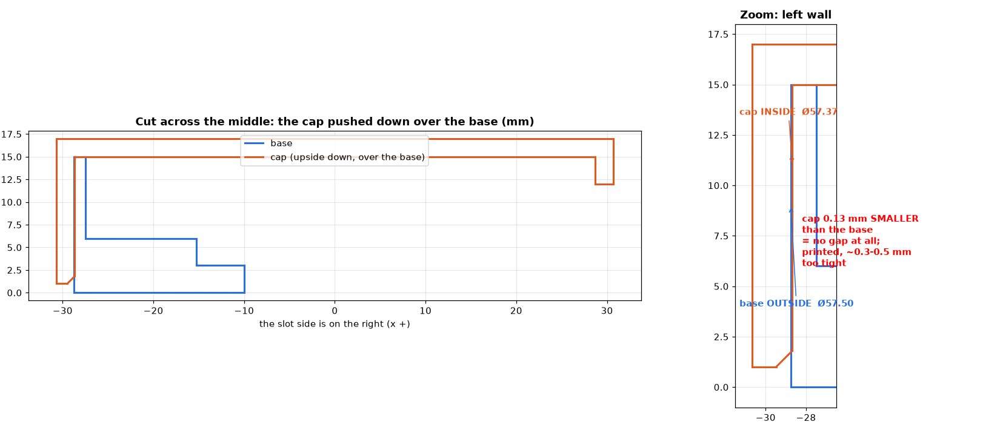

# GPS antenna cover (Cobus, 2026-10-22)

A two-part cover that protects the GPS antenna when the boat is packed in its
bag. Designed by Cobus in SketchUp; the STLs here are his originals.

| Part | File | Size | Notes |
|---|---|---|---|
| Base | `GPS Antenna cover base.stl` | Ø57.5 × 15 mm | 1.25 mm wall; 9.5 mm cable slot in the wall; 5 mm channel in the floor to the Ø19.6 centre hole |
| Cap | `GPS Antenna cover cap.stl` | Ø61.4 × 16 mm | 2 mm wall and top; 5 mm slot, 10.5 mm deep; chamfered opening |

The cap goes upside down over the base, with the slots lined up for the cable.

## Fit note (checked 2026-10-22)

As drawn, the cap's inside (Ø57.37) is **0.13 mm smaller** than the base's
outside (Ø57.50), so there is no clearance. Printed, it is likely 0.3-0.5 mm
too tight. The thin, slotted base wall may flex enough to let the cap on. For a
slip fit, the cap's inside would be about Ø57.9-58.0.

