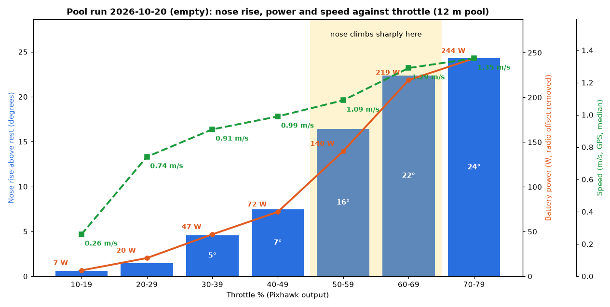
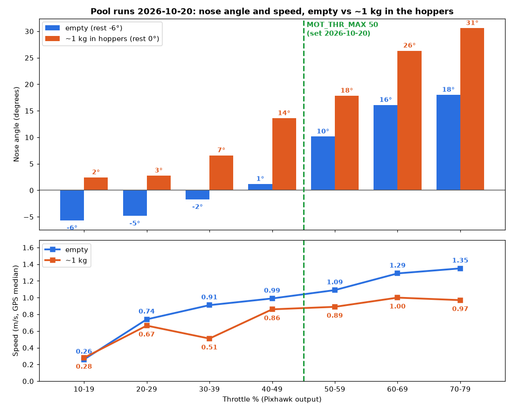
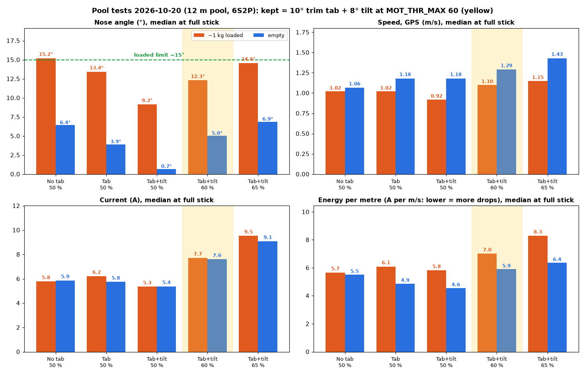
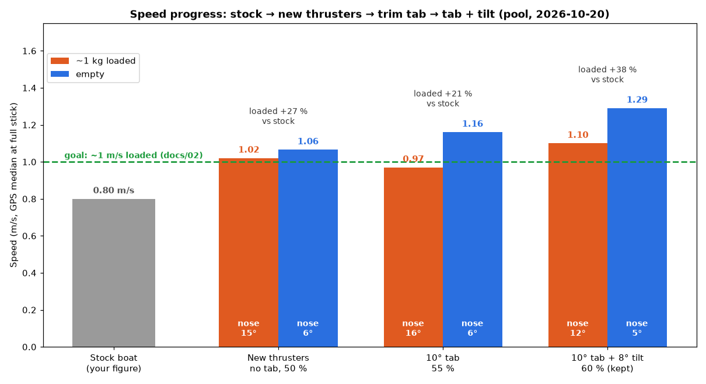
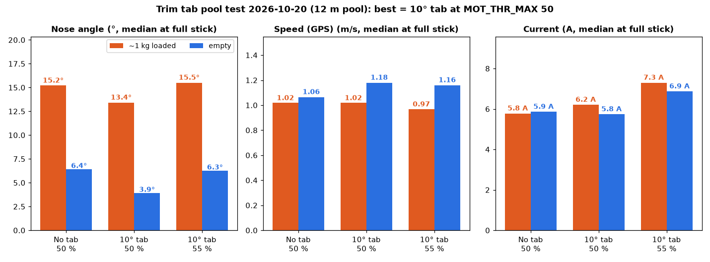

# ArduPilot Rover setup

Settings for the brushless upgrade. The power module and battery sections were set on 2026-10-14; the skid-steering section is still planned.

## Skid steering

| Parameter | Value | Note |
|---|---|---|
| `SERVO1_FUNCTION` | 73 | Throttle left |
| `SERVO3_FUNCTION` | 74 | Throttle right |
| `SERVO1_MIN` / `TRIM` / `MAX` | 1100 / 1500 / 1900 | Same for `SERVO3_*` (read from the boat 2026-10-19; this table said 1000 / 2000 before) |
| `MOT_PWM_TYPE` | 0 | Normal PWM |
| `MOT_THR_MAX` | **60** | 2026-10-20, with the 10° trim tab and 8° tilt carriers fitted (pool tests below; 50 before them, 90 from 2026-10-16, 100 before that). CLIPS the throttle in every mode: Futaba, phone/QGC and missions (Rover 4.7.2 `AP_MotorsUGV::set_throttle`) |
| `MOT_SLEWRATE` | **200** | %/s, set 2026-10-20 (was 0 = no limit). Softens the start so the bow lifts less: 0 to the 50 % limit in 0.25 s. 100 felt laggy; 200 "feels perfect" (Cobus) |

Set both ESCs to bidirectional (3D) mode, with neutral at 1500 µs.

**ESC calibration: not needed (2026-10-16).** Mission Planner's ESC Calibration button is ArduCopter-only (it gives an "AC3" error on Rover). Motor Test (Setup → Optional Hardware) ran both thrusters forward and reverse on the ESCs' default range, so they were left as they came. If one ever creeps at neutral or won't reverse, calibrate by hand: set `SERVO1_FUNCTION` and `SERVO3_FUNCTION` to 53 (RC3 passthrough), power the Pixhawk from USB with the safety switch on, hold the throttle stick at full while plugging in the battery, move it to full low after the beeps, then set them back to 73 / 74.

## Throttle limit from the pool runs (2026-10-20)

Recorded live over the SiK with [`tools/live_record.py`](../tools/live_record.py) (pitch, both outputs, RC, GPS speed, volts, amps at about 4 Hz) in a 12 m pool. Data: [`data/`](../data/). Speeds are pool speeds: the boat may not reach full speed in 12 m.

- **Hull speed is the limit.** Empty, the speed flattens around 1.0-1.3 m/s; loaded (~1 kg in the hoppers) it stops at about **0.9-1.0 m/s** however much throttle (`docs/02` estimated 0.9-1 m/s for this hull). Past that the boat climbs its own bow wave: the **nose rises and the power shoots up** (empty: 72 W at 40-49 % for ~1.0 m/s, 244 W at 70-79 % for ~1.35 m/s).
- **The hoppers sit behind the balance point:** 1 kg in them lifts the nose about 6° at rest (−6° → 0°) and makes it climb further: loaded 26-31° at 60-79 % (peaks 33°) against 16-18° empty. Going out loaded is the steepest part of a drop.
- **The Futaba end point (95 of 140) was about 66-70 % throttle**; a run from the phone (stick centred) reached 77 %. End points never limited phone or mission driving.
- **At the limit, full stick** (medians; loaded / empty):

| `MOT_THR_MAX` | Nose angle | Peak | Speed | Current |
|---|---|---|---|---|
| 45 | 12.8° / 3.5° | 14.0° / 5.2° | 0.90 / 1.04 m/s | 4.5 / 4.8 A |
| **50 (kept)** | **15.2° / 6.4°** | **16.6° / 8.5°** | **1.02 / 1.06 m/s** | **5.8 / 5.9 A** |

  Cobus kept 50: a bit more speed going out loaded. The amps here carry little radio offset (0.7 A at rest that day).
- **Drops per charge (rough):** about 6 A at about 1 m/s; 4,300 mAh usable to the 19.8 V RTL with margin → about **12-13 drops at 100 m** out, **8-9 at 150 m**. Check against a real day out.
- **The boat pulls left on the Futaba with the stick centred**, but both outputs are identical then (1617/1616, 1668/1666, 1764/1764 µs on straight runs), so it is physical: check the props are a mirrored pair (CW + CCW), weed or rubbing in a duct, thruster alignment, or match the ESCs by hand-calibrating (above). Cobus was holding about +25 µs of right steering.
- **Bringing the nose down (same day):**
  - **10° centre trim tab fitted** ([designs/trim](../designs/trim/), on the bases' inboard post screws, no new holes). At 50 %: loaded nose 15.2° → **13.4°**, empty 6.4° → **3.9°**, empty speed 1.06 → **1.18 m/s** at the same current (pool numbers, ±0.05 m/s noise). The flush and 5° tabs were not tested.
  - **55 % with the tab: not worth it.** Loaded no faster (0.97 m/s, the hull-speed wall), nose back to 15.5°, ~18 % more current; empty no faster in the median. Set back to **50 %**.
  - **8° tilt carriers fitted** (same day, [thruster_tilt_carrier.scad](../designs/thruster-mount/thruster_tilt_carrier.scad)), tab still on. **The biggest single gain:** at 50 % loaded nose 13.4° → **9.2°**, empty 3.9° → **0.7°** (nearly level, never bow-down), ~10 % less current.
  - **Then traded for speed** (Cobus: more energy is fine if the nose stays down; loaded limit ~15°):

| Full stick, loaded / empty | Nose | Speed (m/s) | Current (A) | Drops at 100 m (rough) |
|---|---|---|---|---|
| Original: no tab, 50 % | 15.2° / 6.4° | 1.02 / 1.06 | 5.8 / 5.9 | ~12-13 |
| Tab + tilt, 50 % | 9.2° / 0.7° | 0.92 / 1.18 | 5.3 / 5.4 | ~13 |
| **Tab + tilt, 60 % (kept)** | **12.3° / 5.0°** | **1.10 / 1.29** | **7.7 / 7.6** | **~11** |
| Tab + tilt, 65 % | 14.6° / 6.9° (peaks 17.7°) | 1.15 / 1.43 | 9.5 / 9.1 | ~9-10 |

  **Kept 60 %:** loaded 8 % faster and empty 22 % faster than the original setup, with the loaded nose 3° LOWER, leaving margin for wind. 65 % spends that margin for 5 % more loaded speed (the hull-speed wall again). Drops scale with current ÷ speed (energy per metre), see the chart. Battery sagged to 21.5 V by the last set.

Stock 0.8 m/s is Cobus's figure (docs/01 had about 0.7 m/s loaded). Loaded is now +38 % on stock with the nose lower than at any earlier setup; the docs/02 goal of ~1 m/s loaded outbound is met.

## Power module (Holybro PM06 V1) and battery

Fitted 2026-10-14 with the Akita pack: **6S2P Li-ion, 6,000 mAh, no BMS**. With no BMS, the battery failsafe below is the only protection against over-discharge, so keep the voltage calibrated and always balance-charge.

**Cells:** the invoice says "INR18650-30" and the seller said Samsung, so they are taken to be **Samsung INR18650-30Q** (the pack is wrapped, so the label can't be checked). Datasheet figures:

| | Per cell | 6S2P pack |
|---|---|---|
| Charge voltage | 4.20 V | 25.2 V |
| Absolute discharge cut-off | 2.5 V | 15.0 V |
| Max continuous discharge | 15 A | **30 A** |
| Standard / max charge | 1.5 A / 4 A | **3 A** / 8 A |

**Charging:** balance charger on Li-ion, balance lead always plugged in (no BMS), 3 A.
- Before a fishing day: charge to **4.20 V** the night before.
- Storage (a week or more unused): the charger's storage mode, about 3.8 V per cell (22.8 V pack). Sitting full at 4.2 V for weeks ages Li-ion.
- 4.10 V (the charger's default) gives ~90% capacity for longer life. Use it when charging days ahead.

**Watch the 30 A pack limit:** two 480 Kv thrusters on 6S may pull more than that together. On the first run, give it a few seconds at full throttle and read the peak amps on the HUD.

| Parameter | Value | Note |
|---|---|---|
| `BATT_MONITOR` | **4** | Voltage and current (2026-10-19; was 3, voltage only, from 2026-10-16). The amps are **display only**: they read several amps too high from SiK radio interference (see below), so nothing uses them. Reboot after setting |
| `BATT_VOLT_PIN` / `BATT_CURR_PIN` | 2 / 3 | Pixhawk 2.4.8 power port |
| `BATT_VOLT_MULT` | **10.930** | Calibrated 2026-10-14: multimeter 24.34 V, HUD 24.33 V afterwards. The PM06 **V2** value (18.182) read 40.49 V on this V1 |
| `BATT_AMP_PERVLT` | 36.364 | **Not calibrated.** Holybro's published PM06 figure. Their voltage figure (18.182) was badly wrong on this V1, but one PM06 user on the ArduPilot forum calibrated current to 38, so this is probably within ~5%. Correct it with a meter in series, or from the mAh the charger puts back after a run |
| `BATT_CAPACITY` | 6000 | mAh. Needed (anything ≤ 10 reports no % at all, `capacity_remaining_pct()` in AP_BattMonitor_Backend.cpp), but the % shown comes from the **voltage script** below, not from mAh |
| `BATT_AMP_OFFSET` | **0** | Was 0.3793, which had been fitted to radio noise and made readings go negative. With the radio turned down the PM06 read 0.017 V at about 0.6 A, so its true zero is about 0 V |
| `BATT_ARM_VOLT` | 21.6 | 3.6 V per cell: won't arm on a half-flat pack |

Calibrating the voltage: Mission Planner's "Measured battery voltage" box wouldn't edit (under Mono), so work it out by hand: new `BATT_VOLT_MULT` = old × multimeter ÷ HUD.

## Battery failsafe

| Parameter | Value | Note |
|---|---|---|
| `BATT_FS_VOLTSRC` | **0** | Raw voltage (was 1, sag-compensated, changed 2026-10-16: the compensation estimates the pack's resistance from the current reading, which is noise). `BATT_LOW_TIMER` 10 s filters out full-throttle dips |
| `BATT_LOW_VOLT` / `BATT_LOW_MAH` | 19.8 / **0** | 3.3 V per cell. mAh trigger off (2026-10-14) |
| `BATT_LOW_TIMER` | 10 | Seconds |
| `BATT_FS_LOW_ACT` | 1 | RTL |
| `BATT_CRT_VOLT` / `BATT_CRT_MAH` | 18.6 / **0** | 3.1 V per cell. mAh trigger off (2026-10-14). On 2026-10-16 the boat was found with `BATT_CRT_VOLT` at **0** (critical failsafe off, probably zeroed with the mAh one); rewritten to 18.6 and read back |
| `BATT_FS_CRT_ACT` | 1 | RTL too: stranded 180 m out is worse than one deeper discharge |

- **Voltage only, on purpose.** The boat is switched off between drops, and ArduPilot's mAh count starts from zero at every power-up, so mAh triggers (and the HUD's battery %) would read far too full after the first drop. Read the HUD **voltage** before each drop instead.
- **Current: display only (2026-10-19).** `BATT_MONITOR` 4 for live amps, but the failsafes stay voltage-only (`BATT_FS_VOLTSRC` 0, both mAh triggers 0). Treat the amps as a rough indicator under throttle (several amps too high from the radio). The mAh-used figure is meaningless: the script below rewrites it.
- **Battery % from voltage: Lua script [`pixhawk-scripts/batt_volt_pct.lua`](../pixhawk-scripts/batt_volt_pct.lua) (2026-10-19).** Smooths the raw pack voltage over about 30 s and every 5 s sets battery 1's % with `reset_remaining()`, armed or not; it never uses the current. Li-ion curve lined up with the hull gauge: 4.20 V/cell 100 %, 3.90 V 70 %, 3.70 V 45 %, 3.50 V 25 %, 3.30 V 10 % (RTL), 3.10 V 0 % (critical RTL); 6S fixed. Shows in Mission Planner and QGroundControl. ArduPilot's own `BattEstimate.lua` was not used: it only updates while disarmed (this boat is always armed) and uses the current. First run: 24.28 V showed 84 %.
  - Settings: `SCR_ENABLE` **1**; `SCR_HEAP_SIZE` **24576** (the default 44032 left only about 12 KB free on this Pixhawk1 build and MAVFTP failed: "failed to initialize mavftp"; at 24576 about 33 KB is free); `BATT_CAPACITY` 6000.
  - The file lives on the SD card at `APM/scripts/batt_volt_pct.lua` (uploaded over the SiK with MAVFTP and read back identical). To remove: delete it or set `SCR_ENABLE` 0, then power-cycle.
- **mAh used per drop:** Mission Planner, Data screen, Quick tab: double-click a box, tick `battery_usedmah`. It resets at power-up. Each power-up's DataFlash log keeps it as `BAT.CurrTot`, so a day's drops can be added up afterwards.
- **⚠️ Current sensor: the 1 W SiK radio interferes with it (diagnosed 2026-10-19).** 2026-10-16 bench test: idle 14-16 A jumping ±4 A, no response to 16 % / 32 % throttle (a few hundredths of a volt of real signal, buried in the noise). It was first blamed on the adapter's pin 3; that was wrong. 2026-10-19, with a temporary second monitor (BATT2) on the same inputs and a meter on the PM06's pin 3 to pin 5:
  - The adapter cable beeps through on every pin, with no shorts.
  - The PM06 alone with the gauge ESC: a steady 0 V. With the ESC that powers the Pixhawk: jumping 0.06-0.14 V, and **only when the SiK radio is plugged into TELEM1**.
  - Boat radio set to `TXPOWER` 2 (from 11): at rest a steady **0.61 A ± 0.09** (0.017 V). Back at 11: 0.3-16 A, varying from run to run with how the wires lie.
  - A 10k + 100 nF filter at the Pixhawk end ([picture](images/pm06-current-filter.png)) and grounded foil round the PM06 each made **no difference**. The radio signal gets in through the PM06's leads and is turned into false DC inside it, so nothing after that can remove it. The filter was taken out.
  - Not done: `TXPOWER` stays **11** because the link already dropped at about 180 m (Cobus controls the boat from his phone over the SiK; the Futaba is normally off). The boat antenna is sealed into the hull and can't move. A higher shore antenna is the cheapest range gain.
- **`ARMING_REQUIRE` = 0, on purpose (Cobus, 2026-10-16):** the boat is armed from power-on and the motors follow the throttle at once. With the RD-knob bench model on the transmitter, centre RD before powering up. (Bench test over: CH3 is back on J2, 2026-10-16.)
- **Calibrating current from a day out:** new `BATT_AMP_PERVLT` = 36.364 × mAh the charger puts back ÷ total of the logs' final `CurrTot`. More accurate: a DC clamp meter on a battery lead at steady throttle, new = old × clamp ÷ HUD amps.
