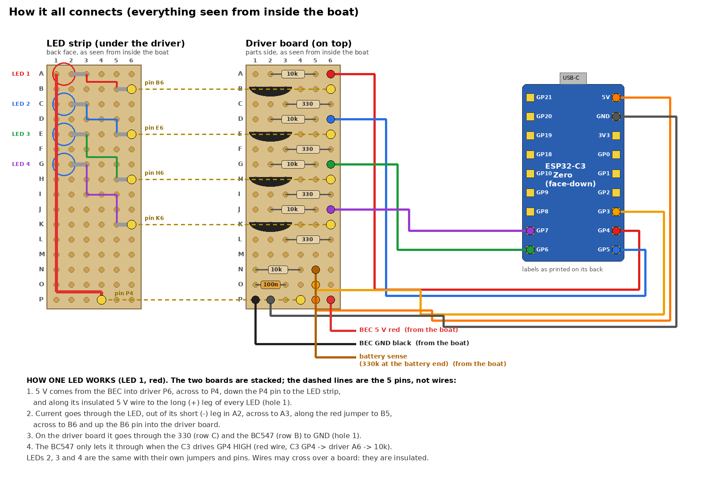
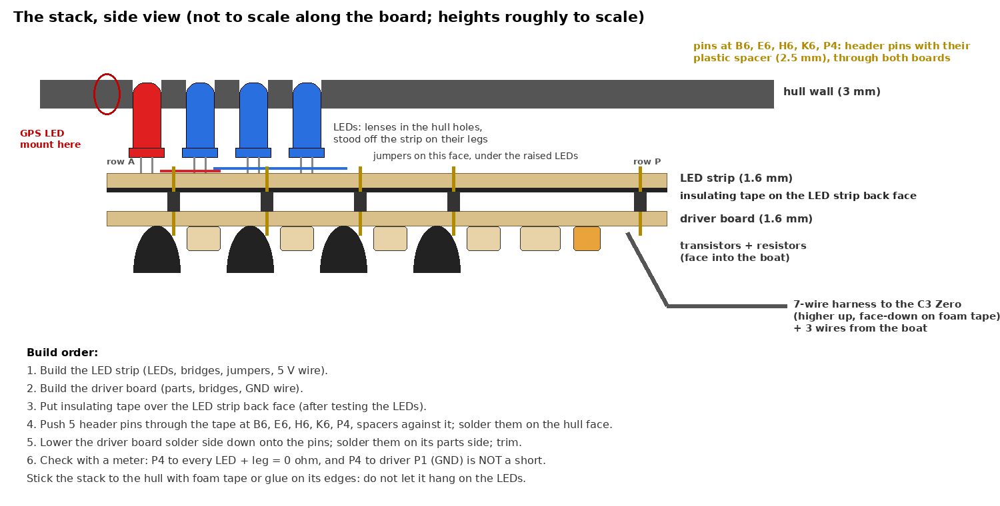
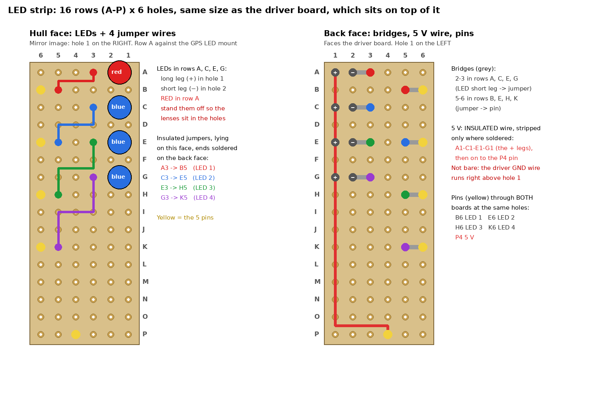
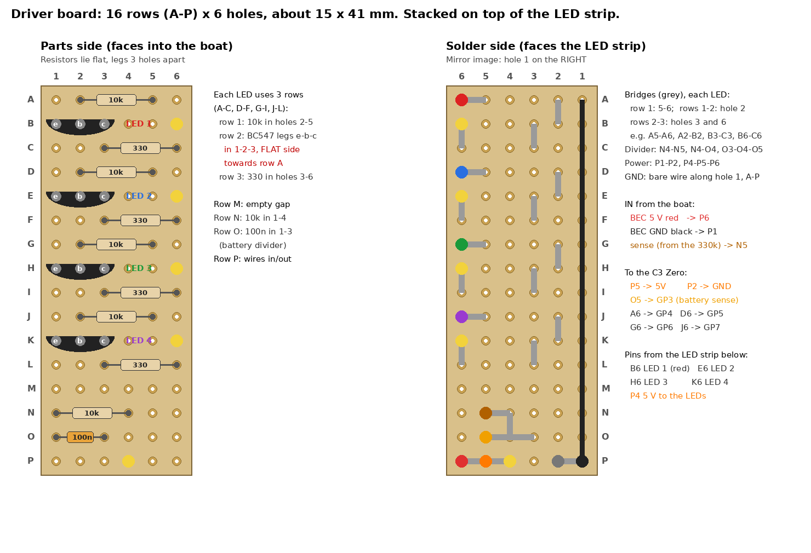
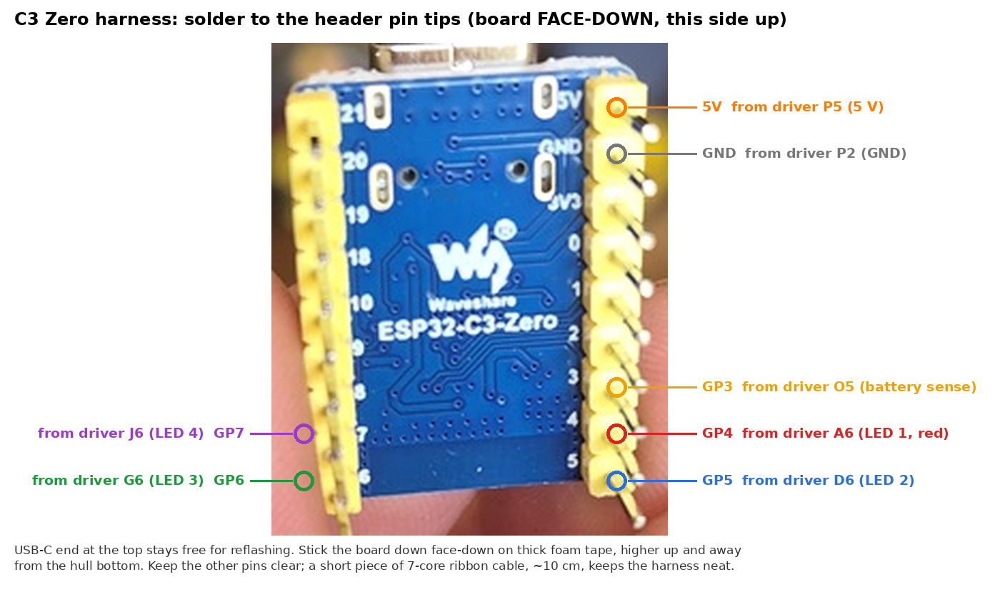
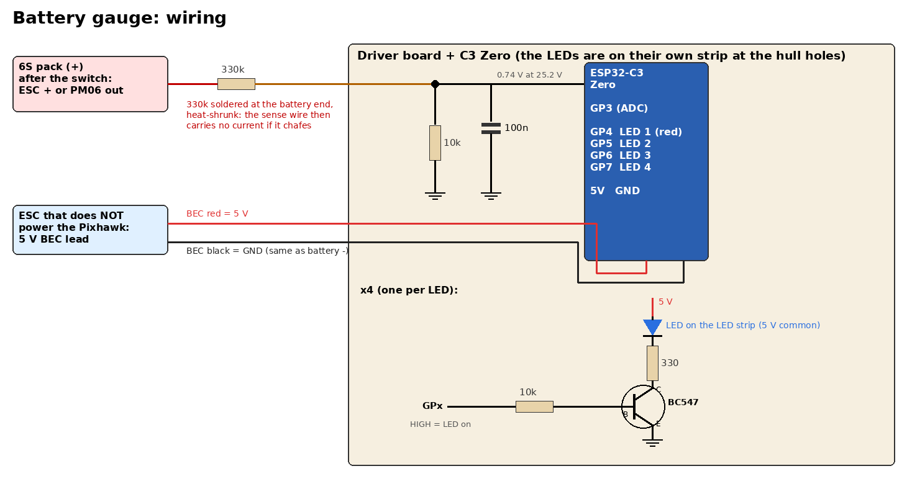

# Battery LED indicator

The stock boat has a 4-LED battery gauge (3 blue + 1 red) that only understands 2S. The first plan was to reuse its LEDs with a small microcontroller; the board is potted with unmarked chips, so it is now replaced outright (below). The Pixhawk battery failsafe stays the real safety net.

## Gauge board (designed 2026-10-16, parts in hand)

The stock board turned out to be resin-potted with unmarked chips, so it is replaced: a **Waveshare ESP32-C3 Zero** driving 4 new 3 mm LEDs (1 red, 3 blue) on a small protoboard strip behind the hull's 4 holes, through a driver board stacked on top of it. The Pixhawk's voltage failsafe stays the real safety net; this is the at-a-glance gauge.

### Where it goes

Two boards stacked into one unit, plus the C3 on its own:

1. **LED strip**, behind the hull's 4 holes: only the LEDs. Its **row A edge sits against the GPS LED mount** (the GPS status LED in its [WS2812D mount](../designs/gps-antenna-spacer/) is right at one end of the hole row).
2. **Driver board**, the same size, **stacked on top of the LED strip** and joined to it by 5 pins (Cobus's idea, 2026-10-16): the transistors, resistors and the battery divider.
3. **ESP32-C3 Zero**, face-down on foam tape, higher up away from the hull bottom, wired to the driver board.

Why: the `PROTO28-DS` strip is only 6 holes wide, the C3's castellated pin rows are about 17.8 mm (7 holes) apart, and the resistors need 2 holes between their legs (legs 3 holes apart, 4 holes in a line), so the drivers can't fit under the LEDs on one board.

Holes are named like the board's own printing: **letters along the length (rows), numbers across the width (holes 1-6)**, so `N5` is row N, hole 5. Both boards are 16 rows (A-P) and line up hole for hole. If your cut pieces are printed differently, go by the pictures.

### LED strip

- Cut to **16 rows (A-P)**, about 15 × 41 mm, the same as the driver board. Cut through the hole row beyond row A, so row A is only 2.5 mm from the edge.
- LEDs in rows A, C, E, G, i.e. 5.08 mm apart, which matches the hull's 5 mm holes, at the strip's side edge (Cobus, 2026-10-16): **long leg (+) in hole 1, short leg (−) in hole 2**. **Red in row A**, next to the GPS LED. Stand them off the strip so the lenses sit in the holes.
- **Back face:** an **insulated** 5 V wire, stripped only where soldered, joins the 4 long legs (A1, C1, E1, G1) and runs on to the 5 V pin at P4. Not bare: the driver board's bare GND wire runs right above hole 1. Bridges 2-3 in rows A, C, E, G, and 5-6 in rows B, E, H, K.
- **Hull face:** 4 insulated jumpers, ends soldered on the back face: A3-B5 (LED 1), C3-E5 (LED 2), E3-H5 (LED 3), G3-K5 (LED 4).
- **Pins** through both boards: B6, E6, H6, K6 (LEDs 1-4) and P4 (5 V).

### Building the stack

1. Build and test the LED strip (5 V on P4 and each LED's pin hole to GND through a 330 Ω lights it).
2. Build the driver board.
3. Put insulating tape over the LED strip's back face.
4. Push 5 header pins through the tape at B6, E6, H6, K6 and P4, plastic spacers against it, and solder them on the hull face.
5. Lower the driver board, **solder side down**, onto the pins; solder them on its parts side and trim.
6. Meter check: P4 to every LED's long leg reads 0 Ω; P4 to driver P1 (GND) is **not** a short.
7. Stick the stack to the hull with foam tape or glue on its edges: don't let it hang on the LEDs. The round ~9 mm mark just above the top LED hole is flat (Cobus, 2026-10-18), so the strip lies flat over it. A light conformal coat covers the leak risk this close to the hull.

### Driver board

- Cut to **16 rows (A-P)**, about 15 × 41 mm. Resistors lie flat with their legs 3 holes apart. Solder side faces the LED strip; the pins land in B6, E6, H6, K6 and P4.
- **Each LED uses 3 rows** (A-C, D-F, G-I, J-L): a 10k in holes 2-5; below it a BC547, legs e-b-c in holes 1-2-3, **flat side towards row A**; below that a 330 Ω in holes 3-6.
- **Bridges on the solder side**, per LED: 5-6 in its first row, hole 2 from the first row to the second, and holes 3 and 6 from the second row to the third (e.g. A5-A6, A2-B2, B3-C3, B6-C6). A bare wire along hole 1 (A-P) is GND; it picks up every emitter.
- **Row M is left empty** as a gap. Row N: the divider's 10k (N1-N4). Row O: the 100 nF (O1-O3). Bridges N4-N5, N4-O4, O3-O4-O5. The **330k goes at the battery end of the sense wire**, heat-shrunk, so the wire carries no current: if it chafes, nothing shorts. O5 then reads about 0.74 V on a full 6S pack (25.2 V).
- 🚨 **330k, not 220k (2026-10-18):** the first build had a low-value resistor in the 220k's place by mistake, so O5 read the full pack voltage and **killed the first C3**. Check the bands: 330k is orange-orange-yellow (4 bands) or orange-orange-black-orange (5 bands). 47k would put 4.4 V on GP3: never use it here. 100k (2.3 V) works but is near the top of the ADC range.
- **Row P:** power in and out. Bridges P1-P2 and P4-P5-P6.

Each LED: 5 V → LED → 330 Ω → BC547 collector; emitter to GND; base through 10k from the GPIO. GPIO HIGH = LED on. About 9 mA red, 6 mA blue.

### C3 Zero harness

Solder the 7 wires to the C3's header pin tips, board face-down (the printed labels are on that side), USB-C end free for reflashing. About 10 cm of 7-core ribbon keeps it neat.

| Driver board | Wire | C3 Zero |
|---|---|---|
| P5 | 5 V | 5V |
| P2 | GND | GND |
| O5 | battery sense (divider node) | GP3 (ADC1) |
| A6 | LED 1 (red) | GP4 |
| D6 | LED 2 | GP5 |
| G6 | LED 3 | GP6 |
| J6 | LED 4 | GP7 |

GPIO choice: GP2, 8 and 9 are boot strapping pins, GP10 is the on-board RGB LED, GP18/19 are USB and GP20/21 the UART, so the LEDs use GP4-7 and the ADC uses GP3.

### Wiring from the boat

| From | To driver board | Note |
|---|---|---|
| Battery + on the **switched** side (an ESC's + or the PM06 output), through the 330k | N5 | Switched, so the divider doesn't drain the pack (no BMS) while the boat is off |
| 5 V BEC red of the ESC that does **not** power the Pixhawk | P6 | Cobus has this lead free. Never two BECs on one rail |
| That BEC's black | P1 | Same as battery − |

### Firmware

[`firmware/battery-gauge/`](../firmware/battery-gauge/) (PlatformIO, same C3 Zero setup as the camping fan). Builds clean (2026-10-16).

| LEDs lit | Per cell (smoothed) | 6S pack |
|---|---|---|
| all 4 (red + 3 blue) | 3.90 V or more | 23.4 V |
| 3 (red + 2 blue) | 3.70 V or more | 22.2 V |
| 2 (red + 1 blue) | 3.50 V or more | 21.0 V |
| red only | 3.30 V or more | 19.8 V, the Pixhawk's RTL level |
| red flashing | below that | come home now |

- Li-ion thresholds (Samsung 30Q, 2.5 V absolute cut-off). Detects 2S (stock pack), 4S or 6S at power-up, and again when a pack is swapped while it runs on USB.
- Smoothed over about 10 s and 0.05 V/cell of hysteresis, so throttle sag doesn't make it flicker.
- At power-up all 4 LEDs light in turn: a dead LED shows straight away. Powered from USB with no pack, the red blinks slowly.
- `RED_AT_GPS_END` and `PIN_LED` at the top of `main.cpp` swap the red to the other end if it is fitted there; `BRIGHT_RED` evens out the brightness.

**Flash and calibrate on the bench, before fitting** (the C3's 5V pin and USB should not both be powered):
1. `pio run -t upload` with the C3 on USB, then `pio device monitor`. Keep the monitor open: the C3's USB serial drops output when nothing is listening.
2. **Before the C3 ever sees the sense wire:** C3 unplugged, pack and BEC connected, measure O5 to battery −. It must read about **0.74 V** on a full pack (0.66 V at storage charge). Full pack voltage means the top resistor is wrong or bypassed: stop. (Cobus's meter, a Fluke 10, does volts and the continuity beeper; a 330k never beeps.)
3. Connect the sense wire (with its 330k) and GND to the pack, still on USB power.
4. Measure the pack with a multimeter and type `cal 24.46` (your reading). It is saved in flash. Every 2 s it prints the pack volts, cell count, level and raw ADC mV.

**Bench test, 2026-10-18 (330k fitted):** on a 4S at 16.19 V (meter) it read 16.21 V, 4 LEDs. On the 6S2P at 24.32 V it read 24.19 V uncalibrated (0.5 % low); `cal 24.32` saved ratio **34.1963** in the C3's flash. All 4 LEDs on, as expected at 4.05 V/cell.

## NeoPixel on AUX 5 (fitted)

Cobus has a NeoPixel driven straight from the Pixhawk's **AUX 5** output. It works.

Since 2026-10-15 the LED is a **WS2812D** (the through-hole one, as on the camping fan). It takes its colours in **RGB** order, not the usual NeoPixel GRB, so with `NTF_LED_TYPES` set to NeoPixel, green showed as red. Fix: in `NTF_LED_TYPES`, untick **NeoPixel** (bit 8) and tick **NeoPixelRGB** (bit 18), then reboot. Both types use the same output (`SERVO13_FUNCTION` = 120, NeoPixel1, on AUX 5), so nothing else changes. NeoPixelRGB needs **Rover 4.5 or newer**. Set and confirmed working 2026-10-15 (green shows green).

| Wire | From | Through | To NeoPixel |
|---|---|---|---|
| Data | AUX 5 signal (3.3 V logic) | **330 Ω resistor**, as close to the LED as possible | DIN |
| Power | 5 V | **diode** (same as the camping fan's) | VDD |
| Ground | AUX ground | | GND |

- **Why the diode on VDD:** the Pixhawk's AUX outputs send a 3.3 V signal. A NeoPixel on a full 5 V wants about 0.7 × VDD (3.5 V) to count as a "high", so 3.3 V falls just short. Fed straight from 5 V it **did not work**. The diode drops VDD so that 3.3 V counts as high.
- **Target VDD: 3.9–4.43 V, measured with the LED dark.** Too high and the data fails, too low and green and blue go dim. This is the same rule as the camping fan, which needed two of Cobus's diodes (about 0.35 V drop each) to reach 4.30 V; one gave 4.67 V and failed. Here, VDD has not been measured yet.
- **Why the 330 Ω resistor:** it limits the current into DIN if data arrives before the LED's supply is up, and it damps ringing on the data line. Solder it inline and heat-shrink it; the hull is damp. (Added 2026-10-15.)
